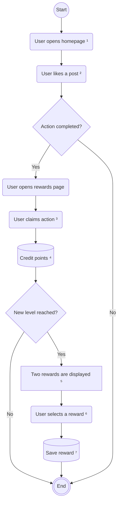
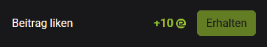
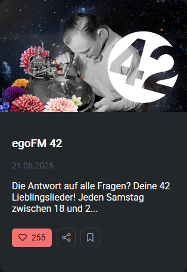
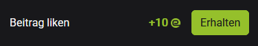
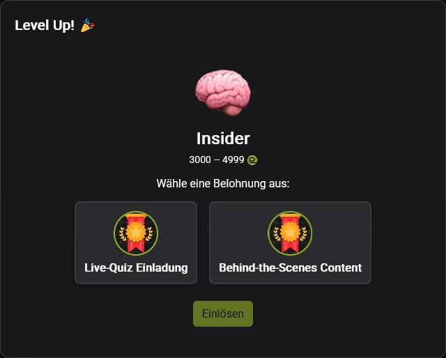
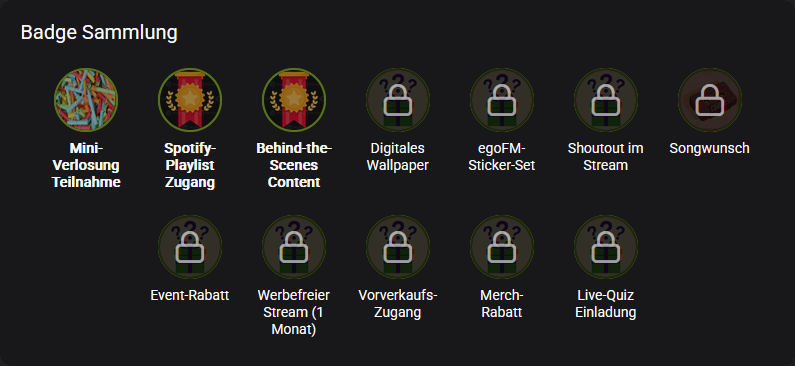

# The Reward Claim Process
This page outlines the user journey of completing a task, claiming its associated reward, and leveling up within the gamification system. A full walkthrough is demonstrated in the screen recording below.  
For a more technical breakdown, including an activity diagram and step-by-step explanation, see the section **Visualization of the Process**.

## Visualization of the process
The following flowchart illustrates the user's progression from performing an action (in this case liking a post) to earning points and claiming rewards as part of the leveling system.

### Step-by-Step Breakdown

1. The user opens the **egofm homepage** ¹.
2. On the **Rewards** page, the action "Like a post" is shown with a disabled **Claim** button, indicating it hasn't been completed yet:  
   

3. The user then **likes a post** ²:  
   

4. A backend action log is created, marking the action as completed. The **Claim** button is now enabled:  
   

5. When the user presses **Claim** ³, points are added to their account ⁴.

6. The system checks whether the new point total results in a **level-up**.

7. If a level-up occurs, **two random rewards** are presented ⁵:  
   

8. The user selects one reward ⁶, which is then saved ⁷ and added to their **badge collection**:  
   
