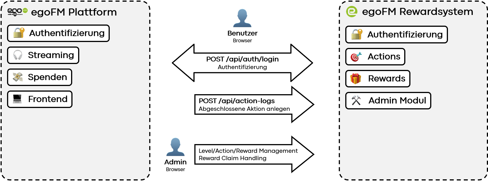

# Interface Documentation & Integration Points

This document describes how the reward system interfaces with an existing system such as egoFM, and outlines the API endpoints, data exchange, and integration scenarios. It is aimed at developers seeking to integrate our prototype into a broader ecosystem.



---

## Frontend Integration

### 1. Existing Home Page Integration

Several UI elements from the reward system can be integrated directly into the existing egoFM homepage:

* **Daily Action Widget**: Show the current daily task and allow one-click completion (linked to `/api/action-logs`)
* **Points & Level Display**: Display current points and level (fetched via `/api/users/me`)
* **Badge Count / Collection**: Total badges or rewards (based on `/api/users/{id}/reward-claims`)
* **Leaderboard Preview**: Top 3 weekly and all-time ranks (via `/api/users/leaderboard`)
* **Streak Component**: Display and animate current streak progress (via `/api/users/me`)

These components can be conditionally rendered if the user is authenticated and identified.

### 2. Dedicated Pages

* **Rewards Page**: Displays available actions, level progress and rewards.
* **Account Page**: Shows personal progress, streaks, claimed rewards and editable user data.

These pages should be accessible via links/buttons integrated into the existing egoFM navigation.

---

## Backend Integration

### 1. Authentication

For demonstration purposes, the prototype includes its own user management and login system:

* `POST /api/auth/login` — Login with username & password
* `POST /api/users` — Create new user (optional for production)

Upon login, the response contains a JWT token and user metadata:

```json
{
  "accessToken": "...",
  "user": {
    "id": "uuid",
    "username": "example",
    "role": "user"
  }
}
```

In a production setup, this should be replaced or synchronized with egoFM’s existing authentication system. Integration options:

* Accept JWTs issued by egoFM’s auth service
* Provide an identity bridge to map authenticated sessions to our reward system

### 2. Actions

Actions represent activities that can be rewarded:

* `GET /api/actions` — Returns all defined actions (filtered via `?activeOnly=true` only returns active actions)
* Example: "Stream 1h", "Invite friend", "Follow on Social Media"

If users perform actions outside the reward system (e.g., streaming, donating), the corresponding event should be logged via:

* `POST /api/action-logs`

```json
{
  "userId": "uuid",
  "actionId": "uuid",
  "metadata": {
    "platform": "instagram"
  }
}
```

This allows external services to trigger point-earning events by simply calling our API.

### 3. Rewards

* `GET /api/rewards` — List available rewards
* `POST /api/reward-claims` — Claim a selected reward (if eligible)
* `GET /api/users/{id}/reward-claims` — View a user’s claimed rewards

The reward system automatically determines reward eligibility based on level and claim status.

---

## Admin & Configuration Interfaces

These endpoints are not exposed to end users and require admin authentication (role: 'admin').

### Levels

* `GET /api/level` — List all levels
* `POST /api/level` — Create new level
* `PUT /api/level/{id}` — Update level
* `DELETE /api/level/{id}` — Remove level

### Actions & Rewards Management

* `GET /api/actions` / `POST` / `PUT` / `DELETE` — Full CRUD for actions
* `GET /api/rewards` / `POST` / `PUT` / `DELETE` — Full CRUD for rewards

### Reward Claims Handling

* `GET /api/reward-claims` — View all reward claims
* `PUT /api/reward-claims/{id}` — Mark as sent / declined / cancelled

This module enables non-technical staff (future: separate Admin UI) to manage incentives and campaigns.

---

## Postman Collection

A [Postman Collection](postman/egoFM_Rewardsystem.postman_collection.json) is provided for convenient testing and integration. It includes:

* Pre-configured JWT authentication
* Example requests for all key endpoints

---

## API Documentation

Full API documentation is available via Swagger:
[http://localhost/api/swagger](http://localhost/api/swagger)

The documentation provides detailed schemas, request/response examples, and authentication mechanisms for all endpoints.
